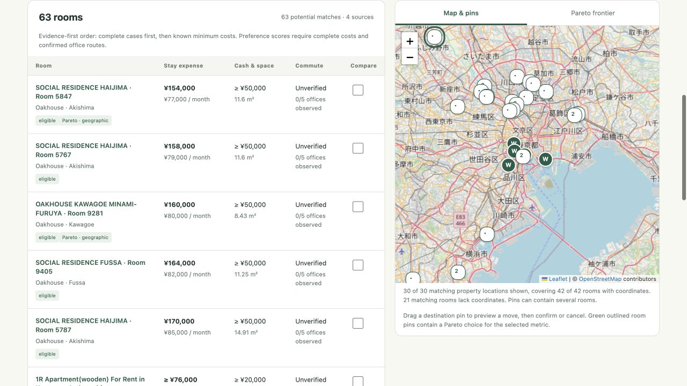
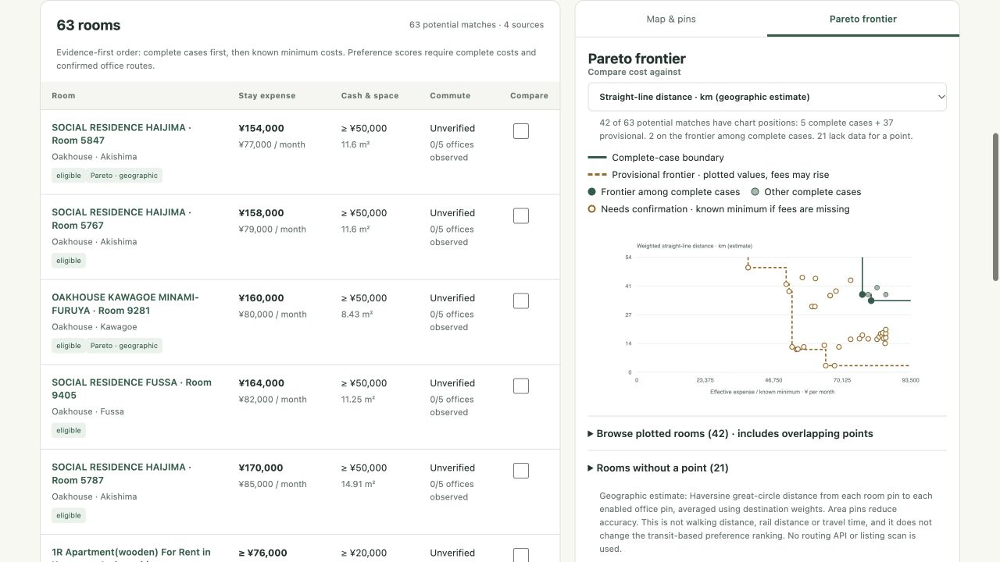
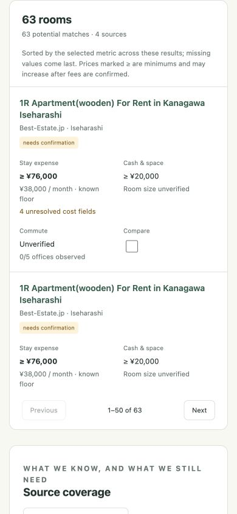

# Japan Housing

A local housing monitor and decision desk for finding a first room in Japan. It collects
room-level listings and connects a searchable list, an editable map, and a **cost/location
Pareto frontier** to help compare places while your work location or length of stay is uncertain.

The focus is on foreign-resident housing in Greater Tokyo: private rooms, share houses,
and compact apartments. Comparisons account for the cost of the whole stay, cash needed
before moving in, and the evidence still missing from each listing.



*Screenshots use a saved September 2026 snapshot; prices and availability are historical.*

[Quick start](#quick-start) · [Dashboard](#using-the-dashboard) ·
[Sources](#sources-and-coverage) · [Configuration](#configuration-and-local-data) ·
[Development](#development)

## Quick start

Requires **Python 3.11+** and [uv](https://docs.astral.sh/uv/). Run from the repository root:

```bash
uv sync --extra dev
```

Review [`config/profile.toml`](config/profile.toml) for your move-in window, budget, and
applicant requirements. The checked-in values are an example search, not recommendations.
Then collect a snapshot and start the dashboard:

```bash
uv run japan-housing bootstrap
uv run japan-housing dashboard
```

Open **<http://127.0.0.1:8766>**. A fresh clone contains no listing data, so bootstrap must
publish a snapshot before the dashboard can show rooms. Partial collection can still produce
a usable snapshot; inspect **Source coverage** for gaps.

Listing collection and geographic comparisons need no API key. The map loads OpenStreetMap
tiles. If you configure a Google Routes key, collection can also make paid route requests;
see [optional integrations](#optional-integrations).

To refresh listings later, run `uv run japan-housing run`, then click **Reload snapshot**.
The button reloads saved results; it does not collect new listings.

## Using the dashboard

Start with **Edit stay, budget & preferences**. Set your dates, effective monthly budget,
room-size requirement, and any upfront cash limit, then **Apply scenario**. The list, map,
chart, comparisons, and exports all use that saved scenario. Move-out is exclusive.

### Map and pins

Use **Edit locations → Drop pin on map** to add possible workplaces, or enter their
coordinates. Give destinations relative weights when some locations matter more than others.
Location comparisons use enabled office destinations, excluding those marked for no office
attendance. Remote work, unknown offices, and relocation possibilities stay separate.

Housing markers group rooms at the same coordinates. Click a marker to choose a room and
open its details. Green outlines identify groups containing a frontier room for the selected
metric. Rooms without coordinates remain accessible in the list.

Drag a destination to preview a move, then confirm or cancel. **Undo last pin change** restores
the previous pin state. Starting pins are approximate areas: confirm office entrances before
relying on transit results. Editing pins does not trigger a crawl or route request.

### Pareto frontier

The frontier shows trade-offs that a single ranking can hide. A cheaper room with a longer
commute and a more expensive room with a shorter commute can both belong on it. A room drops
off the frontier when another comparable room is at least as good on both measures and
strictly better on one.



The horizontal axis is **effective monthly stay expense**. The vertical axis is either:

- **Straight-line distance:** a destination-weighted geographic estimate. It requires room
  and office coordinates, uses no routing API, and does not represent travel time.
- **Observed transit:** destination-weighted one-way minutes. A point requires fresh route
  observations for every relevant office; a partial set of routes is not plotted.

Lower and farther left are better. **Filled points** have complete expenses and meet the
scenario requirements; transit complete cases also require confirmed endpoints. **Green
points and solid steps** highlight their frontier. **Hollow amber points and dashed steps**
show provisional alternatives.
Missing fees make their plotted costs minimums that can rise, so green points are not proven
winners over unverified rooms. Steps mark dominance boundaries, not additional offers.

Select a point to inspect its room. **Browse plotted rooms** exposes overlapping points;
**Rooms without a point** explains missing data. If transit is empty, switch to straight-line
distance or add route evidence. The chart covers filtered potential matches across all list
pages, excludes stale/excluded/reserved/dismissed rooms, and is independent of the preference
weights used for ranking.

### Room lists and comparisons

**Potential matches** includes both rooms meeting requirements and those needing confirmation.
Use **Show** to inspect exclusions or stale records, and **Decision** to return to shortlisted
or contacted rooms. Reserved and dismissed rooms are hidden from the initial view but remain
accessible through their decision filters and **All inventory**.

The initial order favors stronger evidence before applying your preferences. Choose an explicit
sort to compare expense, cash, space, commute, distance, or unresolved costs across evidence tiers.
Unknown values sort last. Search and filters apply to both the list and visualization.

1. **Inspect a room** from the list, map, or chart. Its details show the source link, cost
   breakdown, contract questions, route coverage, and provenance of reviewed facts.
2. **Check up to three rooms**, then choose **View comparison** in the selection tray.
   Compare the same stay and inspect expense curves to see how the ordering changes with
   duration. Dashed curves indicate incomplete costs or unconfirmed/ineligible contract lengths.
3. **Review and record the gaps.** Confirm fees, availability, registration, and screening
   with the operator. Save reviewed facts with their source and note, and update the room's
   decision status as you shortlist or contact it.

Expand **Statistics for this view** to see cost/area distributions, sample sizes, and missing
values. CSV and JSON export the filtered scenario. View settings survive reload in the URL;
comparison selections remain in the current browser tab.

<details>
<summary>Mobile list view</summary>

The same room metrics and comparison controls stack into cards on phones.



</details>

### Reading costs and uncertainty

**Stay expense** includes recurring charges and applicable nonrefundable entry and exit fees.
**Effective monthly expense** spreads that total over the selected stay. **Cash before keys**
is the money needed upfront, including deposits and prepaid rent; a refundable deposit can
increase this amount without increasing the final expense.

A `≥` amount is a **known minimum**, not a complete quote. Unknown charges, refund conditions,
billing rules, and campaign eligibility remain explicit. The same applies to missing room
facts and unobserved commutes: the app leaves them unverified. In room-fact forms, blank keeps
the existing value; enter zero only for a confirmed zero charge.

## Sources and coverage

The automated registry in [`sources.py`](src/japan_housing/sources.py) includes:

| Provider | Source ID |
| --- | --- |
| Oakhouse | `oakhouse` |
| Best-Estate.jp | `best_estate` |
| wagaya Japan | `wagaya` |
| Modern Living | `modern_living` |
| GG House / Tokyo β | `gg_house` |
| Tokyo Sharehouse | `tokyo_sharehouse` |

Adapters use bounded, public, robots-permitted entry pages. They do not cover the entire
market. Other providers appear as reviewed-import or reference links in **Source coverage**;
those are not automated feeds. NAVITIME and Ekispert likewise support reviewed route evidence,
not automatic API requests.

Source coverage shows failures, partial runs, and current/stale records. Failed collection
retains earlier snapshots, and partial crawls cannot close old inventory. Later runs resume
bounded collection work. To refresh one provider, use `uv run japan-housing run --source oakhouse`.
Statistics describe collected listings; possible duplicates and missing evidence limit what
can be inferred about the market.

## Configuration and local data

| Setting | Where to change it |
| --- | --- |
| Collector eligibility, applicant requirements, request budgets, runtime paths, and legacy route anchors | [`config/profile.toml`](config/profile.toml) |
| Stay dates, effective budget, cash limit, room size, preference weights, region, and destinations | Dashboard controls; saved beside the state database in `decision-preferences.json` |

The dashboard reapplies scenario dates, budget, and region while retaining the profile's
applicant and housing requirements. Changing those controls does not expand provider discovery:
for example, choosing Kansai filters stored inventory rather than launching a new regional crawl.

The server is local-only, at `127.0.0.1:8766` unless configured otherwise. SQLite state and
reviewed evidence live in `state/`; generated JSON, CSV, and Markdown reports live in `artifacts/`.
Both directories and `.env` are ignored by Git. Use `uv run japan-housing report` to rebuild
reports from local state without collecting listings.

## Optional integrations

Copy [`.env.example`](.env.example) to `.env` and set only the variables you need.
Environment variables take precedence over the file; keep credentials out of version control.

| Variable | Enables |
| --- | --- |
| `GOOGLE_ROUTES_API_KEY` | Google Routes transit observations for saved office pins, plus collector route matrices |
| `DISCORD_WEBHOOK_URL` | Report updates and listing alerts through explicit notification commands |

Request dashboard transit routes from **room details** after checking the office pins.
Observations are cached for matching endpoints and the configured departure schedule; moving
a pin makes an old route inapplicable. Google Routes may incur usage charges. With routing
enabled and a key available, `bootstrap` and `run` also refresh collector matrices.
The separate `commutes` command uses the TOML station anchors for transit/bicycle diagnostics;
it does not populate the dashboard's custom-office route evidence.

For Discord, `uv run japan-housing bootstrap --notify` syncs the report without baseline
listing alerts. Later `uv run japan-housing run --notify` updates the report and sends
listing alerts using the collector's eligibility rules. An external scheduler can invoke that command
periodically; the application supplies process locking but does not install a schedule.

Use `uv run japan-housing --help` for the full command list. Exit code **2** indicates a partial
result or delivery problem, which may still leave a usable report; inspect the command's JSON
summary and source coverage. Exit codes **0** and **1** indicate success and failure respectively.

## Development

The backend is Python with SQLite and HTTPX. The current frontend uses plain HTML, CSS,
JavaScript modules, SVG charts, and bundled Leaflet; there is no frontend build step.

- [`src/japan_housing/`](src/japan_housing/) — collection, parsing, costs, evidence, scenario
  projection, the local HTTP API, reports, and integrations.
- [`web/index.html`](web/index.html) → [`decision-app.mjs`](web/decision-app.mjs) — current UI
  entry point; map and chart rendering live in `decision-map.mjs` and `decision-charts.mjs`.
- [`tests/`](tests/) — Python fixture/API tests and JavaScript model tests.

```bash
uv run ruff check .
uv run ruff format --check .
uv run pytest
node --test tests/*.mjs
uv run japan-housing benchmark --fixtures tests/fixtures
```

Node is needed for JavaScript tests, not to run the app. Tests use local fixtures and mocked
HTTP; `uv run japan-housing doctor` performs live source/robots checks without writing housing
state. See the [UI and performance audit](docs/ui-audit-2026-09-08.md) for historical browser
checks and measurements.
